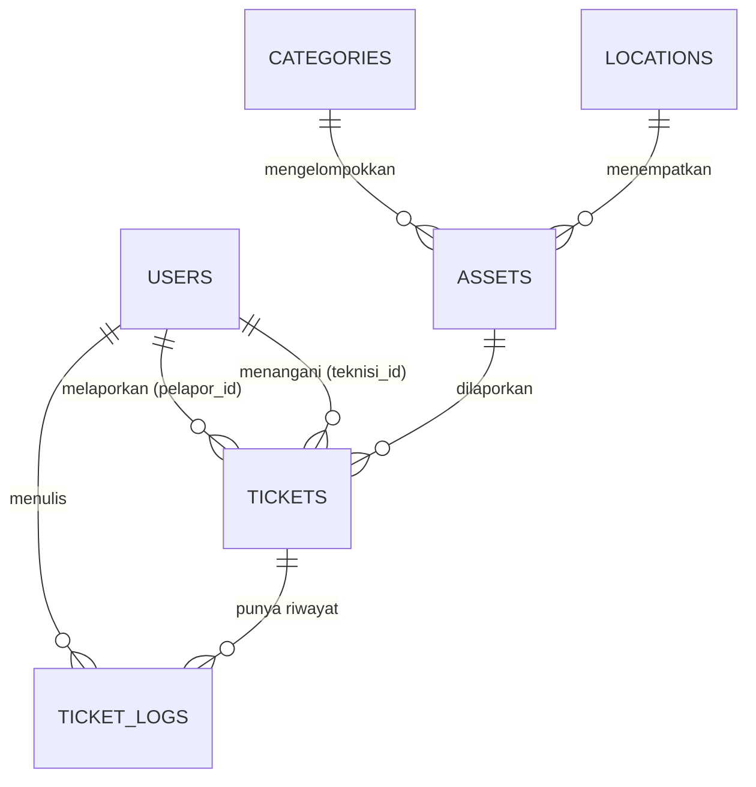

# Inventaris Aset IT & Tiket Perbaikan

Aplikasi web (Laravel + MySQL) untuk mencatat aset IT (komputer, jaringan, CCTV, printer, server) dan mengelola tiket perbaikannya. Dibuat sebagai proyek portofolio untuk lamaran magang konversi (BRITS Hotel dan PT ATI).

## Fitur

- Login dengan 3 role: **admin**, **teknisi**, **staff**
- CRUD aset (kode, kategori, lokasi, merk, serial, IP, tanggal beli, status), dengan pencarian, filter, dan paginasi
- Kategori dan lokasi (admin)
- Tiket perbaikan dengan alur status `baru → diproses → selesai → ditutup`, riwayat (audit log), dan penugasan teknisi
- Status aset otomatis mengikuti tiket (ada tiket baru: `rusak`, sedang diproses: `maintenance`, semua selesai: `aktif`)
- Dashboard ringkasan (query JOIN + GROUP BY)
- Ekspor aset ke CSV
- Hak akses per role, validasi form, soft delete, transaksi database

## Teknologi

PHP 8.2+, Laravel 11/12, MySQL 8, Blade, Bootstrap 5 (CDN, tanpa build step).

## Cara pasang (Windows + Laragon, atau Linux)

Pastikan PHP 8.2+, Composer, dan MySQL sudah terpasang (Laragon sudah membawa semuanya).

```bash
# 1. Buat proyek Laravel baru
composer create-project laravel/laravel inventaris-it
cd inventaris-it

# 2. Salin SELURUH isi folder kit ini ke dalam proyek, timpa file yang sama
#    (routes/web.php, app/Models/User.php, database/seeders/DatabaseSeeder.php)

# 3. Buat database kosong bernama inventaris_it (lewat HeidiSQL/phpMyAdmin), lalu edit .env:
#    DB_CONNECTION=mysql
#    DB_HOST=127.0.0.1
#    DB_PORT=3306
#    DB_DATABASE=inventaris_it
#    DB_USERNAME=root
#    DB_PASSWORD=
#    APP_LOCALE=id
#    APP_NAME="Inventaris IT"
#    (opsional) ubah 'timezone' di config/app.php menjadi 'Asia/Jakarta'

# 4. Buat tabel dan isi data contoh
php artisan migrate --seed

# 5. Jalankan
php artisan serve
```

Buka http://127.0.0.1:8000

Akun demo (password semuanya `password`):

| Email | Role |
|---|---|
| admin@demo.test | admin |
| budi@demo.test / sari@demo.test | teknisi |
| rina@demo.test / andi@demo.test | staff |

Hapus blok "Akun demo" di `resources/views/auth/login.blade.php` sebelum dipakai sungguhan.

## Struktur database (ERD)



Skema SQL lengkap ada di `database/sql/schema.sql`. Latihan query (JOIN, GROUP BY, HAVING, EXISTS, CASE, window function, VIEW) ada di `database/sql/queries.sql`.

## Peta file

| Bagian | File |
|---|---|
| Migration | `database/migrations/2026_11_23_00000*` |
| Model & relasi | `app/Models/` |
| Controller | `app/Http/Controllers/` |
| Validasi | `app/Http/Requests/AssetRequest.php` |
| Role middleware | `app/Http/Middleware/RoleMiddleware.php` |
| Route | `routes/web.php` |
| Tampilan | `resources/views/` |
| Data contoh | `database/seeders/DatabaseSeeder.php` |

## Poin yang bisa dijelaskan saat wawancara

**Untuk PT ATI (database, SDLC, problem solving)**
- Desain database ternormalisasi: 6 tabel, foreign key, `ON DELETE RESTRICT/CASCADE/SET NULL` dipilih sesuai kebutuhan, unique key, index komposit.
- Soft delete pada aset agar riwayat tiket tidak hilang.
- Alur status tiket sebagai state machine sederhana (`Ticket::TRANSITIONS`).
- Query agregasi di dashboard dan di `queries.sql`.
- SDLC yang dipakai: kebutuhan (tiket perbaikan IT) → desain (ERD) → implementasi → pengujian → deployment.

**Untuk BRITS (Laravel, server, jaringan, CCTV)**
- Aset jaringan dan CCTV punya kolom IP address, jadi bisa dipakai sebagai inventaris router, switch, access point, kamera, dan NVR.
- Status aset otomatis (`syncAssetStatus` di `TicketController`), memakai transaksi database.
- Keamanan dasar: CSRF, validasi input, `session()->regenerate()` saat login, pembatasan role, pencegahan IDOR (staff hanya melihat tiketnya sendiri), pencegahan CSV injection pada ekspor.

## Checklist deployment (praktik untuk server sungguhan)

1. `git clone` repo ke server, lalu `composer install --no-dev --optimize-autoloader`
2. Salin `.env`, set `APP_ENV=production`, `APP_DEBUG=false`, kredensial database, lalu `php artisan key:generate`
3. `php artisan migrate --force`
4. Arahkan document root Nginx/Apache ke folder `public/`
5. Beri izin tulis pada `storage/` dan `bootstrap/cache/` untuk user web server
6. `php artisan config:cache && php artisan route:cache && php artisan view:cache`
7. Pasang HTTPS (Let's Encrypt)

## Ide pengembangan lanjutan

- Upload foto kerusakan pada tiket
- Notifikasi email ke teknisi saat tiket baru
- Feature test dengan PHPUnit/Pest (login, hak akses, alur tiket)
- Dashboard grafik (Chart.js)
- REST API dengan Laravel Sanctum, diuji lewat Postman
- Docker Compose (PHP-FPM + Nginx + MySQL)

## Contoh poin untuk CV

> **Sistem Inventaris Aset IT & Tiket Perbaikan** (Laravel, MySQL)
> - Membangun aplikasi web pencatatan aset IT dan tiket perbaikan dengan 3 role pengguna (admin, teknisi, staff).
> - Merancang database relasional 6 tabel lengkap dengan foreign key, index, dan soft delete; menulis query agregasi (JOIN, GROUP BY, window function) untuk dashboard.
> - Mengimplementasikan alur status tiket, audit log, dan sinkronisasi status aset otomatis menggunakan transaksi database.
> - Link: github.com/username/inventaris-it

Tulis hanya yang benar-benar kamu pahami. Telusuri kodenya sampai kamu bisa menjelaskan setiap bagian dengan kata-katamu sendiri.
